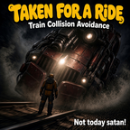

# WePlay: Taken for a Ride — Train Collision Avoidance

**Trains pick you up instead of running you over.** 🚂

A [Factorio](https://factorio.com) 2.1 mod. When a train hits you, it doesn't kill you anymore. It scoops you up into an empty seat and takes you along for the ride.

## Features

- **Free rides, no squishing** — Get hit by a train and you take no damage. You hop right into the car that hit you.
- **Finds you a seat** — If that car's seat is already taken, you go to the nearest empty car on the train.
- **Keeps the schedule** — Automatic trains stay automatic, so you're carried along wherever they were already headed.
- **Full train? No problem** — If every seat is taken, you get bumped safely off the tracks onto the side you were standing on.
- **Works with any rolling stock** — Locomotives, cargo wagons, fluid wagons, and artillery wagons, including modded ones.

## Settings

| Setting | Type | What it does |
|---|---|---|
| **When a train hits you** | Map | **Pick me up** (default) puts you in the train. **Bump me aside** always moves you safely off the tracks instead. |
| **Show flying text** | Per player | Shows *"All aboard!"* or *"Whoa, close one!"* over your character. |

## Installation

Install it from the in-game **Mods** menu (search for *Taken for a Ride*), or download it from the [mod portal page](https://mods.factorio.com/mod/WePlayTakenForARide).

To run it from source, copy or clone this repo into your Factorio `mods` folder as `WePlayTakenForARide`.

## How it works

The mod listens for `on_entity_damaged` on characters. When the damage is `impact` damage caused by rolling stock, it gives the health back. Then it seats the character with `set_driver`, or teleports them clear of the track if the train is full. Only collisions with trains are affected, so cars, tanks, and everything else still hurt.

## Credits

Inspired by the old *Magnet Trains* mod mentioned in the Real Shuttle Trains description.

More WePlay mods: [mods.factorio.com/user/afewvowels](https://mods.factorio.com/user/afewvowels)

## License

Released under [the Unlicense](https://unlicense.org) — public domain. Do whatever you like with it!
